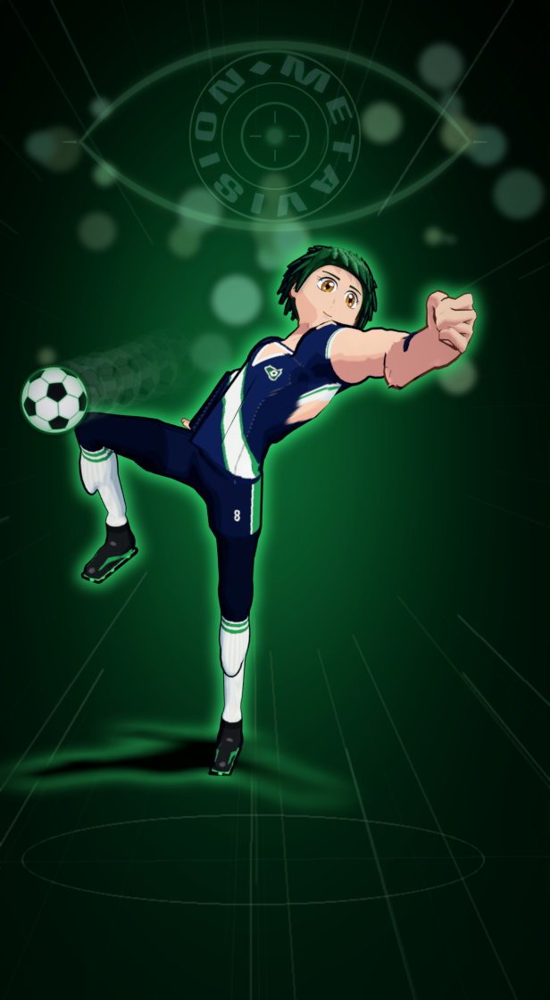
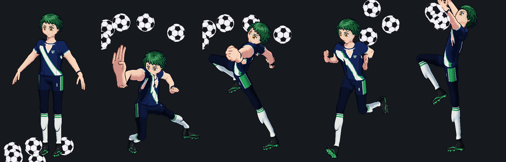
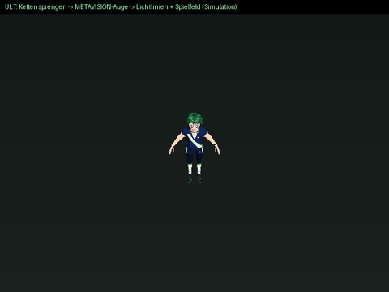

# Flow Striker – Custom-Skin-Mod für Yunara (League of Legends)

Eigener Mod für den **CSLoL Manager**. Er ersetzt Yunaras Standard-Skin (nur bei dir sichtbar).
Alle neuen Grafiken (Fußball, Ketten, METAVISION-Auge, Spielfeld-Linien) sind selbst erstellt.

## Was Version 0.4.0 enthält

| Teil | Änderung |
|---|---|
| Outfit | dunkelblaues Trikot + Shorts, lange dunkelblaue Sporthose darunter (Stutzen darübergezogen) |
| Effekte v0.4 | Fußball-Geschosse mit Glanz + Funkenspur (immer rund), Treffer mit Blitz, Ring, Funken und abprallendem Ball, Krits mit Anime-Aufprallbild + Tornetz, Q mit Lichtsäule + Aura, Sprint mit Nachbildern, Ult mit Speedlines beim Kettenbruch + Lichtstrahlen hinter dem Auge, 15-s-Aura mit Taktik-Ring und kleinem METAVISION-Auge über dem Kopf |
| Modell v2 | echte Finger (bewegen sich mit den Animationen), Fußballschuhe mit Stollen, Armband, Schienbeinschoner, vollere Frisur; Gewichte für Oberkörper/Hände aus Yunaras Original übernommen |
| Licht & Textur | in Blender Cycles gebackenes Licht mit Haar-Schatten auf der Stirn, 3-stufige Anime-Schattierung, Nähte, Seitenteile, eigenes Vereinswappen, Strähnen mit Glanzlichtern, detaillierte Augen |
| Konturlinie | Anime-Outline als Hülle im Modell (Riot blendet Rückseiten aus – sieht man an Yunaras doppelseitigem Stoff) |
| Ladebildschirm & Icons | eigener Ladebildschirm (Volleyschuss) und eigene Porträt-Icons für Minimap/Fähigkeitsleiste |
| Modell (v0.2) | eigener Anime-Fußballstürmer statt Yunara: dunkelgrüne, zur Seite gestylte Frisur, bernsteinfarbene Augen, dunkelgrünes Trikot mit weißer Schärpe und Nummer 8, schwarze Shorts, weiße Stutzen, schwarze Schuhe mit neongrüner Sohle – an Yunaras Skelett gebunden, nutzt ihre Animationen |
| Perlen um den Körper | werden zu 8 echten 3D-Fußbällen (schwarz-weiß) |
| Normale Angriffe, Krits, Q-Angriffe, W | Geschosse sind drehende Fußbälle |
| Q / W | Fußbälle mit dunkelgrünem „Flow“-Leuchten |
| Alle Effekte | Farben auf Dunkelgrün umgestellt |
| Ult (R) aktiv | die 8 Fußbälle bekommen leuchtende Nähte |
| Ult-Aktivierung | Ketten um den Körper → werden gesprengt (Blitz, Splitter, Schockwelle) → über dem Kopf öffnet sich ein Auge, der Ring um die Pupille ist der Schriftzug **METAVISION** → zerfällt in Lichtlinien, die ein Spielfeld auf den Boden zeichnen |
| W während der Ult | Fußball mit leuchtenden Nähten |

## Installieren (CSLoL Manager)

1. CSLoL Manager öffnen.
2. Auf **„Add mod“** (Plus-Symbol) klicken und `FlowStriker_Yunara_v0.4.0.fantome` auswählen.
3. Häkchen beim Mod setzen, dann **„Run“** drücken.
4. League starten und im Übungstool Yunara mit dem **Standard-Skin** spielen.

Custom Skins sind von Riot nicht offiziell erlaubt – Nutzung auf eigenes Risiko. Nach LoL-Patches kann ein Update nötig sein.

## Vorschau







## Selbst neu bauen

```bash
tools/fetch_game_files.sh /tmp/yunara
cd tools && python3 make_assets.py && python3 build_mod.py /tmp/yunara
```

Benötigt: Python 3, `pip install numpy pillow xxhash`. Ergebnis liegt in `build/`.

## Aufbau

- `tools/lolbin.py` – liest/schreibt League-`.bin`-Dateien (Effekt-Definitionen)
- `tools/lolskn.py` – liest/schreibt das Modell (`.skn`)
- `tools/make_assets.py` – erzeugt alle eigenen Grafiken (`assets_src/gen/`)
- `tools/build_mod.py` – baut daraus die `.fantome`-Datei
- `assets_src/fonts/` – Schrift „Big Shoulders“ (SIL Open Font License)
- `tools/char/` – Modell-Pipeline des Stürmers: `design.py` (Formen per Signed-Distance-Modellierung),
  `blender_mesh.py` / `blender_bake.py` / `blender_rig.py` (Blender als Python-Modul: Aufräumen, UVs,
  Baken, Gewichte), `texture.py` (Anime-Bemalung), `animtest.py` (Test mit echten Animationen),
  `run_all.sh` (alles neu erzeugen). Ergebnis liegt in `assets_src/char/`.
- `tools/char/*2.py`, `run_v2_all.sh` – Modell v2 (Finger, Stollen, Cycles-Licht-Bake, Textur v2, Rig mit Fingern);
  `blender_render.py` + `compose.py` – Cycles-Renders, Ladebildschirm und Icons
- `tools/vfxsim.py`, `tools/vfx_preview.py` – Effekt-Simulator für Vorschau-GIFs (Näherung, nicht das Spiel)
- `tools/char/import_model.py` + [MODEL_SWAP.md](MODEL_SWAP.md) – anderes Modell einsetzen
- `tools/fetch_wad.py` – lädt Yunaras Spielarchiv direkt von Riots Update-Server (für Skelett/Animationen)
