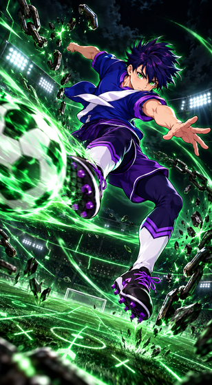
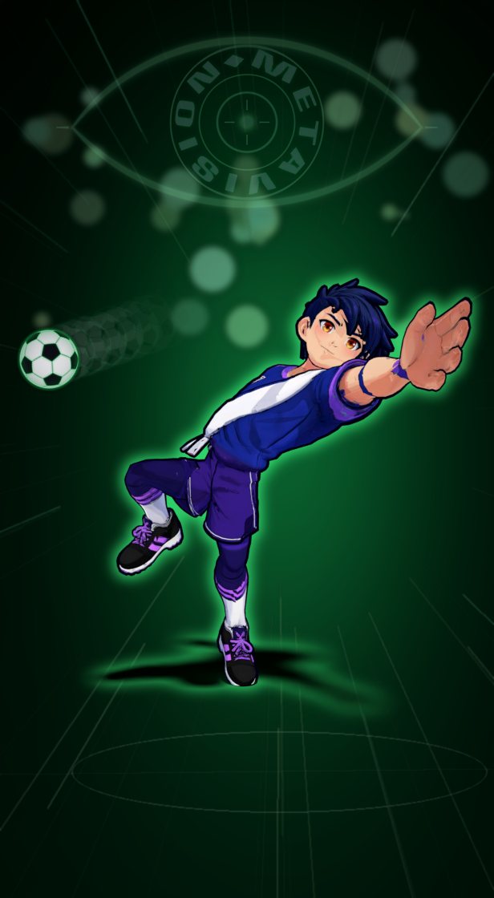
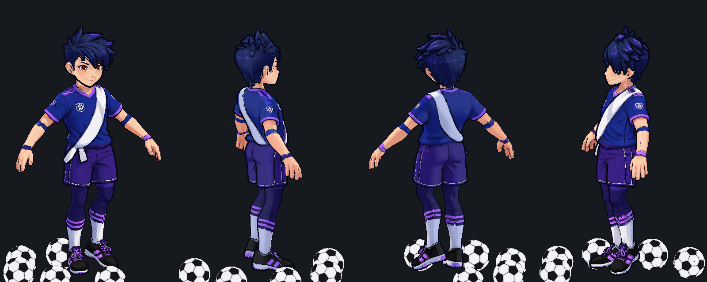
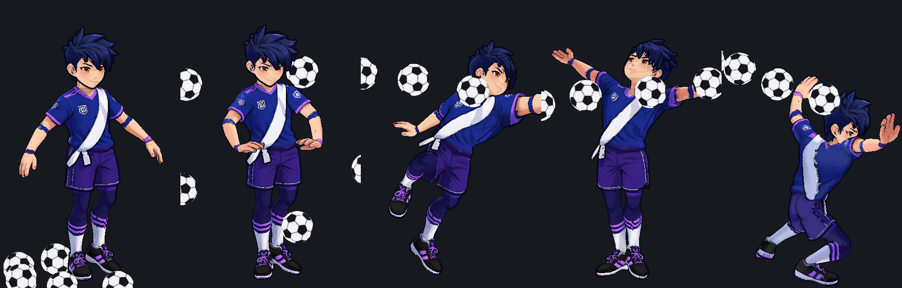
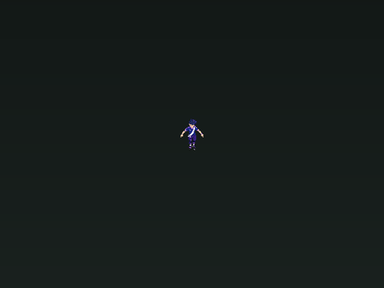
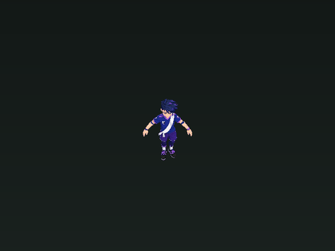

# Flow Striker – Custom-Skin-Mod für Yunara (League of Legends)

Eigener Mod für den **CSLoL Manager**. Er ersetzt Yunaras Standard-Skin (nur bei dir sichtbar).
Alle neuen Grafiken (Fußball, Ketten, METAVISION-Auge, Spielfeld-Linien) sind selbst erstellt.

## Was Version 0.8.0 enthält

| Teil | Änderung |
|---|---|
| Ketten am Bildschirm (neu in v0.8) | während der ganzen Ult (15 s) hängen in den vier Ecken **deines eigenen Bildschirms** Ketten: sie schießen hinein, bohren sich mit Pflöcken ins Bild und werden ruckartig festgezogen, zucken danach immer wieder unter Spannung, Licht läuft über die Glieder, Funken knistern; kurz vor Ult-Ende glühen sie auf und sprengen sich weg. Nur du siehst sie (gleiche Technik wie Riots Bildschirm-Effekte bei Vi, Yone und Aatrox: an die Kamera geheftet, nur für den Besitzer sichtbar) |
| Neue Ult-Vorschläge (v0.8) | vier neue, von Blue Lock inspirierte eigene Ults als Pakete `*_ult-beast` (Ego-Bestie: Meshy-Schattenwesen steigt hinter ihm auf, brüllt, sprengt seine Ketten, stürzt in ihn), `*_ult-echoes` (Zukunfts-Echos: 4 Hologramm-Kopien von ihm in Aktionsposen, nur die richtige Zukunft bleibt), `*_ult-popup` (Aufklapp-Spielfeld wie ein Pop-up-Buch), `*_ult-stage` (Weltbühne No.1: Spotlight, Kamerablitze, Ranglisten-Säule) – jeweils mit Vorschauvideo. Alles räumlich Verteilte steht fest in der Welt und dreht sich nicht mit, wenn er sich dreht |
| Recall: Torjubel (v0.8) | beim Zurückkehren baut sich ein Tor aus Licht um ihn auf, er jongliert den Ball, am Ende bauscht sich das Netz, Konfetti fliegt |
| Laufspuren (v0.8) | bei jedem Schritt (genau auf den Bodenkontakt der Laufanimation) Kreide-Striche und Rasen-Fetzen |
| Q: Flow-Aura (v0.8) | während Q steigen weiß-violette Funken von Haaren, Schultern und Füßen auf, dazu leuchtende Nachbild-Fußabdrücke |
| Respawn: Anstoß (v0.8) | Mittelkreis zeichnet sich auf den Boden, Flutlichtkegel fällt auf ihn, Ball auf dem Anstoßpunkt |
| Tod: Abpfiff (v0.8) | Pfiff-Wellen, Pfeifen-Symbol, graue Schockwelle, der Ball rollt davon, das Augenleuchten erlischt |
| Blinzeln (v0.8) | eigene „Augen zu“-Ebene (Meshy-Bearbeitung des eigenen Gesichts), wird in Steh- und Laufanimationen regelmäßig kurz eingeblendet |
| Ladebildschirm (v0.8) | neues Anime-Keyart (Volley mit grün glühendem Ball, Flutlicht, berstende Ketten), mit Meshy aus dem eigenen Render erzeugt |
| Gesichtsausdrücke (v0.7) | 7 Ausdrücke aus Meshy-Bildbearbeitungen des eigenen Gesichts: konzentriert (Angriffe, E), Kampfschrei (Krits, W, R-W), Grinsen (Spott, Witz, Rückkehr), Lachen (Tanz), Schmerz (Tod, Hochgeschleudert); werden pro Animation über Riots Submesh-Events eingeblendet. Q-Flow: weiß-violett leuchtende Augen mit Muster-Iris, Ult: grüne Metavision-Augen |
| Textur-Fehler behoben (v0.7) | Farbschmierer an Texturnähten (z. B. lila Strich auf dem Unterarm), Flecken auf Arm- und Handgelenkbändern, Nahtlinien (Kanten-Padding), einfarbige Bänder |
| Ult-Vorschläge (v0.7) | vier alternative Ults als eigene Pakete in `build/` (`*_ult-puzzle`, `*_ult-neuro`, `*_ult-manga`, `*_ult-radar`) mit Vorschauvideo; das Hauptpaket behält das Hologramm-Stadion |
| Farben (neu in v0.6) | Stürmer in Blau-Lila: königsblaues Trikot, violette Akzente (Kragen, Ärmelsäume, Stutzenstreifen, Schnürsenkel, Wappen), tiefviolette Shorts, indigo Strumpfhose, dunkelblaue Haare mit violettem Schimmer; Bernsteinaugen bleiben. Effekte bleiben dunkelgrün |
| Ult: Hologramm-Stadion (neu) | METAVISION baut beim Aktivieren ein Stadion aus grünen Hologrammen: vier Flutlichtmasten wachsen aus dem Boden und schalten flackernd ihre Lichtkegel auf den Stürmer, ringsum blitzen Handykameras wie auf der Tribüne; fünf Geister-Verteidiger bauen sich Scan für Scan auf, bekommen Zielmarkierungen und zerspringen in Splitter; dann erscheint ein Holo-Tor, ein Ball wird hineingeschossen, das Netz beult aus, Lichtblitz + Lichtbrechung + Konfetti. Masten und Verteidiger mit Meshy modelliert, Hologramm-Look mit Riots Fresnel-Rand und Auflöse-Effekt |
| Q als Flow-Zustand (neu in v0.6.1) | alle Q-Effekte in Weiß → Lavendel → Violett mit weichen Übergängen (helle Kerne weiß, verblassende Ränder violett): Licht wird in den Stürmer gesogen und bricht aus, danach leuchtender weiß-violetter Konturrand um den ganzen Körper, aufsteigende Lichtschleier, violetter Schein, Funkeln, Konturen-Nachbilder beim Bewegen, Lichtspuren hinter Händen und kreisenden Bällen; Q-Bälle und Q-Treffer weiß-violett |
| Animationen geprüft (v0.6.1) | alle 72 Animationen Bild für Bild am Modell geprüft (Vorschauvideo); Riots extreme Dehn-Effekte (Arme/Beine/Wirbelsäule bis +80 %) auf ±10 % begrenzt, damit nichts gestreckt oder kaputt aussieht |
| Ult-Aura (neu) | alle ~1,4 s gleitet ein Scanner-Ring über den Stürmer („METAVISION liest das Spiel“) |
| Modell (neu in v0.5) | viel detaillierterer Anime-Stürmer (eigenes Design, mit Meshy erzeugt): dunkelgrüne, zur Seite gestylte Haare, bernsteinfarbene Augen, dunkelblaues Trikot mit weißer Schärpe und Wappen, lange dunkelblaue Strumpfhose unter den Shorts, weiße Stutzen mit grünen Streifen, schwarze Stollenschuhe – mit seinen eigenen Anime-Proportionen |
| Eigenes Skelett (neu) | die Knochen sitzen an den Gelenken des Stürmers; alle 72 Animationen von Yunara werden beim Bauen darauf umgerechnet (gleiche Bewegungen, Bein- und Armlängen angepasst, Füße bleiben am Boden) |
| Licht & Textur (neu) | Licht mit echten Schatten und Umgebungsverdeckung vom 680.000-Dreiecke-Originalmodell gebacken, 3-stufige Anime-Schattierung (kühle Stoffschatten, warme Hautschatten), flach beleuchtetes Gesicht mit Haarschatten, feine Randlicht-Kante in Flow-Grün; eigenes Vereinswappen auf beiden Ärmeln, KI-Artefakte (markenähnliches Logo, Fantasie-Abzeichen) entfernt |
| Ladebildschirm & Icons | neu gerendert mit dem neuen Modell (Volleyschuss + Porträt) |
| Konturlinie | Anime-Outline als Hülle im Modell (Riot blendet Rückseiten aus – sieht man an Yunaras doppelseitigem Stoff) |
| Effekte v0.4 | Fußball-Geschosse mit Glanz + Funkenspur (immer rund), Treffer mit Blitz, Ring, Funken und abprallendem Ball, Krits mit Anime-Aufprallbild + Tornetz, Q mit Lichtsäule + Aura, Sprint mit Nachbildern, Ult mit Speedlines beim Kettenbruch + Lichtstrahlen hinter dem Auge, 15-s-Aura mit Taktik-Ring und kleinem METAVISION-Auge über dem Kopf |
| Älteres Modell | der selbst gebaute Stürmer v2 (ohne Meshy) ist weiter im Projekt: `{"model": "striker2"}` in `assets_src/char/model.json` |
| Perlen um den Körper | werden zu 8 echten 3D-Fußbällen (schwarz-weiß) |
| Normale Angriffe, Krits, Q-Angriffe, W | Geschosse sind drehende Fußbälle |
| Q / W | Fußbälle mit dunkelgrünem „Flow“-Leuchten |
| Alle Effekte | Farben auf Dunkelgrün umgestellt |
| Ult (R) aktiv | die 8 Fußbälle bekommen leuchtende Nähte |
| Ult-Aktivierung | Ketten um den Körper → werden gesprengt (Blitz, Splitter, Schockwelle) → über dem Kopf öffnet sich ein Auge, der Ring um die Pupille ist der Schriftzug **METAVISION** → zerfällt in Lichtlinien, die ein Spielfeld auf den Boden zeichnen |
| W während der Ult | Fußball mit leuchtenden Nähten |

## Installieren (CSLoL Manager)

1. CSLoL Manager öffnen.
2. Auf **„Add mod“** (Plus-Symbol) klicken und `FlowStriker_Yunara_v0.8.0.fantome` auswählen.
3. Häkchen beim Mod setzen, dann **„Run“** drücken.
4. League starten und im Übungstool Yunara mit dem **Standard-Skin** spielen.

Der Mod ist für den Standard-Skin gedacht. Wenn du einen anderen Yunara-Skin spielen willst, schalte ihn vorher ab.

### Ketten am Bildschirm prüfen

Die Ketten hängen an der Kamera. Falls sie bei deiner Bildschirmauflösung nicht genau in den Ecken sitzen
(z. B. bei Ultrawide-Monitoren), schick einen Screenshot während der Ult – die Position ist eine Zahl im Build
(`tools/screen_chains.py`: `HALF_W`, `HALF_H`, `CHAIN_S`).

### Falls das Spiel abstürzt

1. CSLoL Manager auf die neueste Version aktualisieren (nach LoL-Patches die häufigste Ursache).
2. Ältere Versionen dieses Mods im CSLoL Manager entfernen, nur eine Version aktivieren.
3. Zum Eingrenzen nacheinander die Testpakete probieren (`build/FlowStriker_TEST_nur-Modell_*.fantome` und
   `FlowStriker_TEST_nur-Effekte_*.fantome`, jeweils allein aktiv) und die Log-Datei
   `League of Legends/Logs/GameLogs/<neuester Ordner>/…_r3dlog.txt` mitschicken.

v0.5.1: alle Texturen jetzt im DXT-Format wie bei Riot (vorher unkomprimiert), Ladebildschirm/Icons ohne Mipmaps
wie im Original, Modell-Datei mit Riots Endmarke; Paket 11 statt 24 MB.

Custom Skins sind von Riot nicht offiziell erlaubt – Nutzung auf eigenes Risiko. Nach LoL-Patches kann ein Update nötig sein.

## Vorschau



Vorschauvideos v0.8 (Simulation): `build/Ult2_1_Ego-Bestie.mp4`, `Ult2_2_Zukunfts-Echos.mp4`, `Ult2_3_Aufklapp-Spielfeld.mp4`,
`Ult2_4_Weltbuehne-No1.mp4` (jeweils mit den Bildschirm-Ketten und dem Ult-Ende) und `Extras_v0.8.mp4`.












Vorschauvideo mit allen 72 Animationen: `tools/char/anim_video.py` (siehe unten).


## Selbst neu bauen

```bash
tools/fetch_game_files.sh /tmp/yunara
git clone https://github.com/CommunityDragon/CDTB /tmp/cdtb
python3 tools/fetch_wad.py /tmp/yunara/Yunara.wad.client /tmp/cdtb
python3 tools/extract_wad.py /tmp/yunara/Yunara.wad.client /tmp/yunara
cd tools && python3 make_assets.py && python3 build_mod.py /tmp/yunara      # "all" als 2. Argument baut auch die Testpakete
```

Benötigt: Python 3, `pip install numpy pillow xxhash pyritofile pyzstd`. Ergebnis liegt in `build/`.
Die Zeilen 2–4 holen Yunaras Skelett und Animationen aus Riots Spielarchiv; der Build rechnet sie auf das Skelett des
Stürmers um. Riots Dateien landen nie im Repository.

## Aufbau

- `tools/lolbin.py` – liest/schreibt League-`.bin`-Dateien (Effekt-Definitionen)
- `tools/lolskn.py` – liest/schreibt das Modell (`.skn`)
- `tools/make_assets.py` – erzeugt alle eigenen Grafiken (`assets_src/gen/`)
- `tools/build_mod.py` – baut daraus die `.fantome`-Datei
- `assets_src/fonts/` – Schrift „Big Shoulders“ (SIL Open Font License)
- `tools/char/` – Modell-Pipeline des Stürmers: `design.py` (Formen per Signed-Distance-Modellierung),
  `blender_mesh.py` / `blender_bake.py` / `blender_rig.py` (Blender als Python-Modul: Aufräumen, UVs,
  Baken, Gewichte), `texture.py` (Anime-Bemalung), `animtest.py` (Test mit echten Animationen),
  `run_all.sh` (alles neu erzeugen). Ergebnis liegt in `assets_src/char/`.
- `tools/char/*2.py`, `run_v2_all.sh` – Modell v2 (Finger, Stollen, Cycles-Licht-Bake, Textur v2, Rig mit Fingern);
  `blender_render.py` + `compose.py` – Cycles-Renders, Ladebildschirm und Icons
- `tools/vfxsim.py`, `tools/vfx_preview.py` – Effekt-Simulator für Vorschau-GIFs (Näherung, nicht das Spiel)
- `tools/char/import_model.py` + [MODEL_SWAP.md](MODEL_SWAP.md) – anderes Modell einsetzen
- `tools/fetch_wad.py` – lädt Yunaras Spielarchiv direkt von Riots Update-Server (für Skelett/Animationen)
- `tools/extract_wad.py` – holt daraus Skelett, Animationsgraph und alle Animationen für den Build
- `tools/stadium_fx.py` – Hologramm-Stadion der Ult (Masten, Verteidiger, Tor, Lichtkegel, Zeitachse);
  `tools/char/vfx_mesh.py` macht aus Meshy-Modellen leichte Effekt-Meshes (`assets_src/vfx/`)
- `tools/char/anim_video.py` + `posebin.py` + `tools/ltk_pose_dump/` (C#, LeagueToolkit) – Vorschauvideo: jede Animation
  exakt ausgewertet am Modell, danach die Effekte
- `tools/bcn.py` – DXT1/DXT5-Kodierung der Texturen (wie Riot), `tools/validate_bin.py` – prüft Bins gegen Riots Klassenschema
- `tools/char/meshy_prep.py`, `meshy_repose.py`, `meshy_bake.py`, `meshy_texture.py` – Pipeline für das Meshy-Modell:
  reduzieren (682.000 → 26.000 Dreiecke), Arme/Beine in Yunaras Grundpose drehen, Licht vom Originalmodell backen,
  Anime-Schattierung + Textur-Aufräumen (siehe [MODEL_SWAP.md](MODEL_SWAP.md))
- `tools/screen_chains.py` – Ketten-Overlay an den Bildschirmecken (Kamera-gebunden, nur für den Spieler, am R-Buff);
  `tools/char/screen_overlay.py` simuliert es für die Videos
- `tools/ult_variants2.py` – die vier neuen Ult-Vorschläge (`ULT_VARIANT=beast|echoes|popup|stage`);
  `tools/char/echo_meshes.py` friert den Stürmer in vier Posen als Effekt-Meshes ein
- `tools/general_fx.py` – Recall-Torjubel, Laufspuren, Q-Aura + Nachbild-Abdrücke, Respawn-Anstoß, Tod-Abpfiff
  (Riots Partikel-Events in den Animationen bzw. Buff-Bedingungen); `tools/char/extras_video.py` – Vorschauvideo
- `tools/check_package.py` – prüft ein fertiges Paket: WAD-Sortierung + Prüfsummen, Bins gegen das Klassenschema und
  gegen alle Feld-Kombinationen, die Riot selbst in seinen Skins benutzt
- `tools/char/custom_skeleton.py` – eigenes Skelett (Yunaras Datei, nur Gelenkpositionen geändert) und Umrechnung der
  Animationen (alle drei Riot-Formate, Rotationen bleiben bitgenau)
