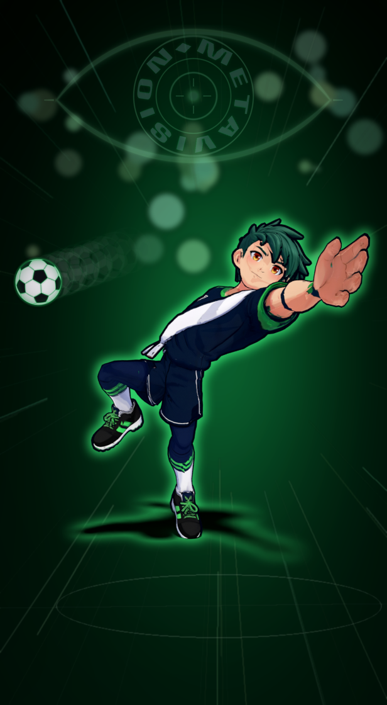
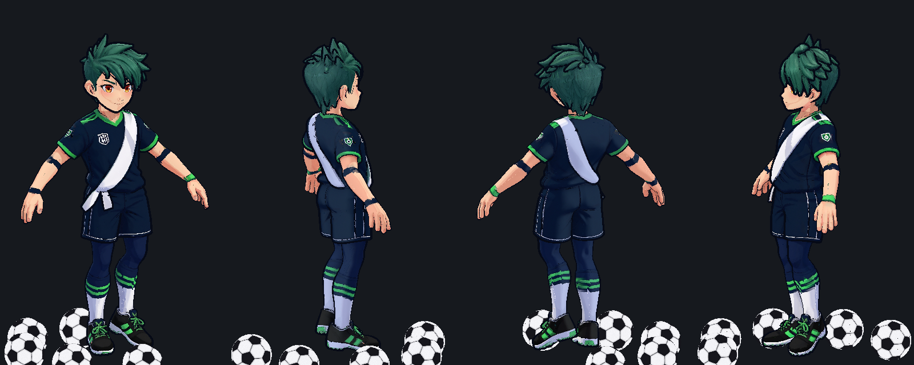
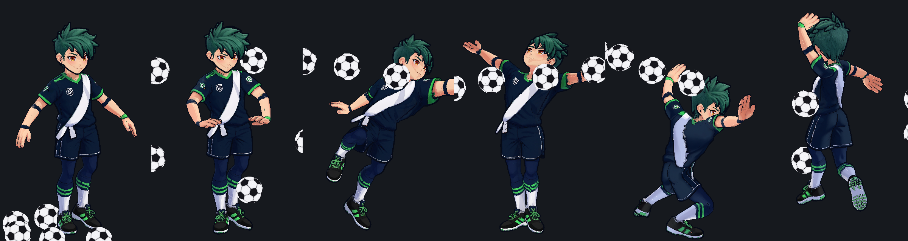

# Flow Striker – Custom-Skin-Mod für Yunara (League of Legends)

Eigener Mod für den **CSLoL Manager**. Er ersetzt Yunaras Standard-Skin (nur bei dir sichtbar).
Alle neuen Grafiken (Fußball, Ketten, METAVISION-Auge, Spielfeld-Linien) sind selbst erstellt.

## Was Version 0.5.1 enthält

| Teil | Änderung |
|---|---|
| Modell (neu in v0.5) | viel detaillierterer Anime-Stürmer (eigenes Design, mit Meshy erzeugt): dunkelgrüne, zur Seite gestylte Haare, bernsteinfarbene Augen, dunkelblaues Trikot mit weißer Schärpe und Wappen, lange dunkelblaue Strumpfhose unter den Shorts, weiße Stutzen mit grünen Streifen, schwarze Stollenschuhe – mit seinen eigenen Anime-Proportionen |
| Eigenes Skelett (neu) | die Knochen sitzen an den Gelenken des Stürmers; alle 72 Animationen von Yunara werden beim Bauen darauf umgerechnet (gleiche Bewegungen, Bein- und Armlängen angepasst, Füße bleiben am Boden) |
| Licht & Textur (neu) | Licht mit echten Schatten und Umgebungsverdeckung vom 680.000-Dreiecke-Originalmodell gebacken, 3-stufige Anime-Schattierung (kühle Stoffschatten, warme Hautschatten), flach beleuchtetes Gesicht mit Haarschatten, feine Randlicht-Kante in Flow-Grün; eigenes Vereinswappen auf beiden Ärmeln, KI-Artefakte (markenähnliches Logo, Fantasie-Abzeichen) entfernt |
| Ladebildschirm & Icons | neu gerendert mit dem neuen Modell (Volleyschuss + Porträt) |
| Konturlinie | Anime-Outline als Hülle im Modell (Riot blendet Rückseiten aus – sieht man an Yunaras doppelseitigem Stoff) |
| Effekte v0.4 | Fußball-Geschosse mit Glanz + Funkenspur (immer rund), Treffer mit Blitz, Ring, Funken und abprallendem Ball, Krits mit Anime-Aufprallbild + Tornetz, Q mit Lichtsäule + Aura, Sprint mit Nachbildern, Ult mit Speedlines beim Kettenbruch + Lichtstrahlen hinter dem Auge, 15-s-Aura mit Taktik-Ring und kleinem METAVISION-Auge über dem Kopf |
| Älteres Modell | der selbst gebaute Stürmer v2 (ohne Meshy) ist weiter im Projekt: `{"model": "striker2"}` in `assets_src/char/model.json` |
| Perlen um den Körper | werden zu 8 echten 3D-Fußbällen (schwarz-weiß) |
| Normale Angriffe, Krits, Q-Angriffe, W | Geschosse sind drehende Fußbälle |
| Q / W | Fußbälle mit dunkelgrünem „Flow“-Leuchten |
| Alle Effekte | Farben auf Dunkelgrün umgestellt |
| Ult (R) aktiv | die 8 Fußbälle bekommen leuchtende Nähte |
| Ult-Aktivierung | Ketten um den Körper → werden gesprengt (Blitz, Splitter, Schockwelle) → über dem Kopf öffnet sich ein Auge, der Ring um die Pupille ist der Schriftzug **METAVISION** → zerfällt in Lichtlinien, die ein Spielfeld auf den Boden zeichnen |
| W während der Ult | Fußball mit leuchtenden Nähten |

## Installieren (CSLoL Manager)

1. CSLoL Manager öffnen.
2. Auf **„Add mod“** (Plus-Symbol) klicken und `FlowStriker_Yunara_v0.5.1.fantome` auswählen.
3. Häkchen beim Mod setzen, dann **„Run“** drücken.
4. League starten und im Übungstool Yunara mit dem **Standard-Skin** spielen.

Der Mod ist für den Standard-Skin gedacht. Wenn du einen anderen Yunara-Skin spielen willst, schalte ihn vorher ab.

### Falls das Spiel abstürzt

1. CSLoL Manager auf die neueste Version aktualisieren (nach LoL-Patches die häufigste Ursache).
2. Ältere Versionen dieses Mods im CSLoL Manager entfernen, nur eine Version aktivieren.
3. Zum Eingrenzen nacheinander die Testpakete probieren (`build/FlowStriker_TEST_nur-Modell_*.fantome` und
   `FlowStriker_TEST_nur-Effekte_*.fantome`, jeweils allein aktiv) und die Log-Datei
   `League of Legends/Logs/GameLogs/<neuester Ordner>/…_r3dlog.txt` mitschicken.

v0.5.1: alle Texturen jetzt im DXT-Format wie bei Riot (vorher unkomprimiert), Ladebildschirm/Icons ohne Mipmaps
wie im Original, Modell-Datei mit Riots Endmarke; Paket 11 statt 24 MB.

Custom Skins sind von Riot nicht offiziell erlaubt – Nutzung auf eigenes Risiko. Nach LoL-Patches kann ein Update nötig sein.

## Vorschau








## Selbst neu bauen

```bash
tools/fetch_game_files.sh /tmp/yunara
git clone https://github.com/CommunityDragon/CDTB /tmp/cdtb
python3 tools/fetch_wad.py /tmp/yunara/Yunara.wad.client /tmp/cdtb
python3 tools/extract_wad.py /tmp/yunara/Yunara.wad.client /tmp/yunara
cd tools && python3 make_assets.py && python3 build_mod.py /tmp/yunara      # "all" als 2. Argument baut auch die Testpakete
```

Benötigt: Python 3, `pip install numpy pillow xxhash pyritofile pyzstd`. Ergebnis liegt in `build/`.
Die Zeilen 2–4 holen Yunaras Skelett und Animationen aus Riots Spielarchiv; der Build rechnet sie auf das Skelett des
Stürmers um. Riots Dateien landen nie im Repository.

## Aufbau

- `tools/lolbin.py` – liest/schreibt League-`.bin`-Dateien (Effekt-Definitionen)
- `tools/lolskn.py` – liest/schreibt das Modell (`.skn`)
- `tools/make_assets.py` – erzeugt alle eigenen Grafiken (`assets_src/gen/`)
- `tools/build_mod.py` – baut daraus die `.fantome`-Datei
- `assets_src/fonts/` – Schrift „Big Shoulders“ (SIL Open Font License)
- `tools/char/` – Modell-Pipeline des Stürmers: `design.py` (Formen per Signed-Distance-Modellierung),
  `blender_mesh.py` / `blender_bake.py` / `blender_rig.py` (Blender als Python-Modul: Aufräumen, UVs,
  Baken, Gewichte), `texture.py` (Anime-Bemalung), `animtest.py` (Test mit echten Animationen),
  `run_all.sh` (alles neu erzeugen). Ergebnis liegt in `assets_src/char/`.
- `tools/char/*2.py`, `run_v2_all.sh` – Modell v2 (Finger, Stollen, Cycles-Licht-Bake, Textur v2, Rig mit Fingern);
  `blender_render.py` + `compose.py` – Cycles-Renders, Ladebildschirm und Icons
- `tools/vfxsim.py`, `tools/vfx_preview.py` – Effekt-Simulator für Vorschau-GIFs (Näherung, nicht das Spiel)
- `tools/char/import_model.py` + [MODEL_SWAP.md](MODEL_SWAP.md) – anderes Modell einsetzen
- `tools/fetch_wad.py` – lädt Yunaras Spielarchiv direkt von Riots Update-Server (für Skelett/Animationen)
- `tools/extract_wad.py` – holt daraus Skelett, Animationsgraph und alle Animationen für den Build
- `tools/bcn.py` – DXT1/DXT5-Kodierung der Texturen (wie Riot), `tools/validate_bin.py` – prüft Bins gegen Riots Klassenschema
- `tools/char/meshy_prep.py`, `meshy_repose.py`, `meshy_bake.py`, `meshy_texture.py` – Pipeline für das Meshy-Modell:
  reduzieren (682.000 → 26.000 Dreiecke), Arme/Beine in Yunaras Grundpose drehen, Licht vom Originalmodell backen,
  Anime-Schattierung + Textur-Aufräumen (siehe [MODEL_SWAP.md](MODEL_SWAP.md))
- `tools/char/custom_skeleton.py` – eigenes Skelett (Yunaras Datei, nur Gelenkpositionen geändert) und Umrechnung der
  Animationen (alle drei Riot-Formate, Rotationen bleiben bitgenau)
